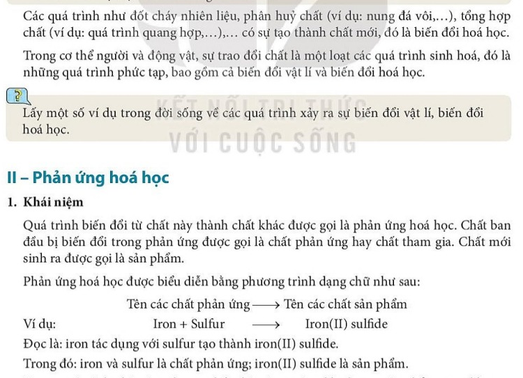
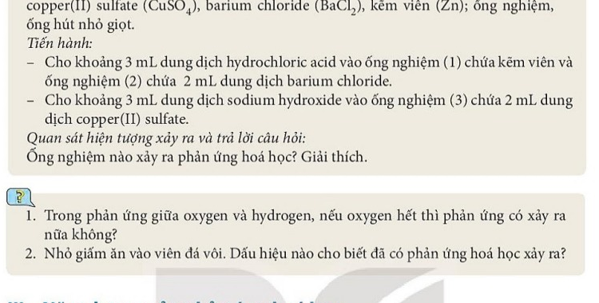

# CHƯƠNG I. PHẢN ỨNG HÓA HỌC

---

# BÀI 2. PHẢN ỨNG HÓA HỌC

| Khái niệm, thuật ngữ | Kiến thức, kĩ năng |
|---|---|
| - Biến đổi vật lí, biến đổi hoá học - Phản ứng hoá học - Chất phản ứng, sản phẩm - Phản ứng toả nhiệt, thu nhiệt | - Phân biệt được biến đổi vật lí và biến đổi hoá học. - Nêu được khái niệm phản ứng hoá học, chất phản ứng và sản phẩm. - Chỉ ra được các dấu hiệu chứng tỏ có phản ứng hoá học xảy ra. - Phân biệt được phản ứng toả nhiệt và phản ứng thu nhiệt. |

---

## 1. Biến đổi vật lí và biến đổi hoá học

### Khái niệm
- **Biến đổi vật lí:** Là hiện tượng chất biến đổi về trạng thái, hình dạng, kích thước nhưng **vẫn giữ nguyên là chất ban đầu** (không có chất mới tạo thành).
  - *Ví dụ:* Nước đá tan thành nước lỏng; nước lỏng sôi bốc hơi thành hơi nước; bẻ gãy đinh sắt; hòa tan đường vào nước.
- **Biến đổi hoá học:** Là hiện tượng chất biến đổi **tạo ra chất khác** (có chất mới sinh ra với tính chất mới).
  - *Ví dụ:* Đinh sắt để ngoài không khí ẩm bị gỉ sét; than củi cháy tạo thành khí carbon dioxide; tôi vôi sống tạo vôi tôi.

> [!NOTE]
> **Dấu hiệu then chốt để phân biệt:**
> Căn cứ duy nhất để khẳng định một hiện tượng là biến đổi hoá học là **có chất mới xuất hiện** hay không.

### Thí nghiệm biến đổi hoá học (Sắt tác dụng với Lưu huỳnh):
- Trộn đều bột sắt ($\mathrm{Fe}$) màu xám đen với bột lưu huỳnh ($\mathrm{S}$) màu vàng theo tỉ lệ khối lượng $7 : 4$.
- Đưa nam châm lại gần hỗn hợp: Nam châm hút sắt ra khỏi hỗn hợp $\rightarrow$ Đây là hiện tượng vật lí.
- Cho hỗn hợp vào ống nghiệm, đun nóng trên ngọn lửa đèn cồn: Hỗn hợp cháy đỏ rực rồi lan tỏa nhiệt mạnh, tạo thành hợp chất sắt(II) sulfide ($\mathrm{FeS}$) màu đen xám.
- Đưa nam châm lại gần chất rắn sau phản ứng: Nam châm **không còn hút** được chất rắn này nữa.
$$\mathrm{Fe} + \mathrm{S} \xrightarrow{t^\circ} \mathrm{FeS}$$

---

## 2. Khái niệm phản ứng hoá học

> [!NOTE]
> **Định nghĩa:**
> **Phản ứng hoá học** là quá trình biến đổi từ chất này thành chất khác.
> - Chất ban đầu bị biến đổi trong phản ứng gọi là **chất phản ứng** (hoặc chất tham gia).
> - Chất mới sinh ra sau phản ứng gọi là **sản phẩm**.

### Phương trình chữ của phản ứng hoá học:
$$\text{Tên các chất phản ứng} \rightarrow \text{Tên các sản phẩm}$$

*Ví dụ:* Khi than (thành phần chính là carbon) cháy trong không khí (oxygen):
$$\text{Carbon} + \text{Oxygen} \xrightarrow{t^\circ} \text{Carbon dioxide}$$
- Chất phản ứng: Carbon và Oxygen.
- Sản phẩm: Khí Carbon dioxide.

### Bản chất của phản ứng hoá học:
Trong phản ứng hoá học, **liên kết giữa các nguyên tử bị thay đổi**, làm cho phân tử này biến đổi thành phân tử khác (kết quả là chất này biến đổi thành chất khác).
> Các nguyên tử được bảo toàn (số lượng nguyên tử mỗi nguyên tố trước và sau phản ứng không thay đổi).

---

## 3. Dấu hiệu nhận biết có phản ứng hoá học xảy ra

Phản ứng hoá học thường đi kèm một hoặc nhiều dấu hiệu nhận biết sau:
1. **Có sự thay đổi màu sắc:** Chất mới có màu khác với chất ban đầu.
2. **Xuất hiện chất khí (sủi bọt khí):** Có khí bay lên ($\uparrow$), ví dụ kẽm tác dụng dung dịch acid:
   $$\mathrm{Zn} + 2\mathrm{HCl} \rightarrow \mathrm{ZnCl}_2 + \mathrm{H}_2 \uparrow$$
3. **Xuất hiện chất kết tủa (chất không tan):** Có hạt rắn lắng xuống ($\downarrow$), ví dụ dung dịch barium chloride gặp natri sulfate:
   $$\mathrm{BaCl}_2 + \mathrm{Na}_2\mathrm{SO}_4 \rightarrow \mathrm{BaSO}_4 \downarrow + 2\mathrm{NaCl}$$
4. **Có sự phát sáng hoặc toả nhiệt:** Nhiệt độ của môi trường phản ứng tăng lên rõ rệt.

---

## 4. Phản ứng toả nhiệt và phản ứng thu nhiệt

### Phản ứng toả nhiệt
- Là phản ứng **giải phóng năng lượng** (dưới dạng nhiệt năng) ra môi trường xung quanh.
- *Hiện tượng:* Cốc đựng hỗn hợp phản ứng nóng lên.
- *Ví dụ:* Phản ứng cháy của xăng dầu, củi; phản ứng vôi sống tác dụng với nước:
  $$\mathrm{CaO} + \mathrm{H}_2\mathrm{O} \rightarrow \mathrm{Ca(OH)}_2 + \text{Nhiệt năng}$$

### Phản ứng thu nhiệt
- Là phản ứng **hấp thụ năng lượng** (dưới dạng nhiệt năng) từ môi trường xung quanh.
- *Hiện tượng:* Cốc đựng hỗn hợp phản ứng lạnh đi (nhiệt độ giảm xuống) hoặc phản ứng cần đun nóng liên tục mới diễn ra.
- *Ví dụ:* Nung đá vôi ($\mathrm{CaCO}_3$) sản xuất vôi sống; nhiệt phân thuốc tím ($\mathrm{KMnO}_4$) điều chế khí oxygen trong phòng thí nghiệm:
  $$\mathrm{CaCO}_3 \xrightarrow{t^\circ} \mathrm{CaO} + \mathrm{CO}_2 \uparrow$$

> [!TIP]
> **Ứng dụng thực tiễn:**
> - Các phản ứng toả nhiệt như đốt cháy than củi, khí gas thiên nhiên được ứng dụng làm nhiên liệu đun nấu, sưởi ấm, vận hành động cơ nhiệt.
> - Túi chườm lạnh khẩn cấp trong y tế dùng cho vận động viên bị chấn thương hoạt động dựa trên sự hòa tan thu nhiệt của một số muối amoni.
