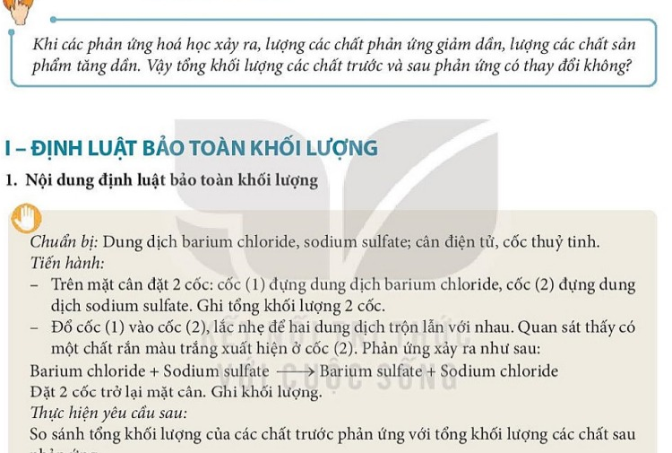

# CHƯƠNG I. PHẢN ỨNG HÓA HỌC

---

# BÀI 5. ĐỊNH LUẬT BẢO TOÀN KHỐI LƯỢNG VÀ PHƯƠNG TRÌNH HÓA HỌC

| Khái niệm, thuật ngữ | Kiến thức, kĩ năng |
|---|---|
| - Định luật bảo toàn khối lượng - Phương trình hoá học (PTHH) - Hệ số cân bằng | - Phát biểu được định luật bảo toàn khối lượng. - Viết được biểu thức định luật bảo toàn khối lượng cho một phản ứng cụ thể. - Nêu được ý nghĩa của phương trình hoá học. - Lập được phương trình hoá học của phản ứng đơn giản bằng phương pháp chẵn lẻ hoặc nguyên tử. |

---

## 1. Định luật bảo toàn khối lượng

### Thí nghiệm kiểm chứng:
- Đặt lên đĩa cân hai cốc chứa: cốc (1) đựng dung dịch barium chloride ($\mathrm{BaCl}_2$), cốc (2) đựng dung dịch sodium sulfate ($\mathrm{Na}_2\mathrm{SO}_4$).
- Đọc số chỉ của cân: giả sử là $m_1\text{ gam}$.
- Đổ dung dịch từ cốc (1) vào cốc (2): xuất hiện kết tủa trắng barium sulfate ($\mathrm{BaSO}_4$).
- Đặt lại hai cốc lên đĩa cân, đọc số chỉ của cân: vẫn là $m_1\text{ gam}$ (kim cân không đổi).

> [!NOTE]
> **Nội dung định luật (Lomonosov & Lavoisier):**
> Trong một phản ứng hoá học, **tổng khối lượng của các chất sản phẩm bằng tổng khối lượng của các chất phản ứng**.

### Biểu thức của định luật:
Giả sử có phản ứng: $\mathrm{A} + \mathrm{B} \rightarrow \mathrm{C} + \mathrm{D}$
$$m_{\mathrm{A}} + m_{\mathrm{B}} = m_{\mathrm{C}} + m_{\mathrm{D}}$$

*Giải thích bản chất:* Trong phản ứng hoá học, chỉ có liên kết giữa các nguyên tử thay đổi, còn **số lượng nguyên tử của mỗi nguyên tố được giữ nguyên**. Vì khối lượng của từng nguyên tử không đổi nên tổng khối lượng các chất trước và sau phản ứng được bảo toàn tuyệt đối.

*Ví dụ:* Nung $100\text{ gam}$ đá vôi ($\mathrm{CaCO}_3$) thu được $56\text{ gam}$ vôi sống ($\mathrm{CaO}$) và khí carbon dioxide ($\mathrm{CO}_2$). Tính khối lượng khí $\mathrm{CO}_2$ thoát ra:
$$m_{\mathrm{CaCO}_3} = m_{\mathrm{CaO}} + m_{\mathrm{CO}_2}$$
$$\implies m_{\mathrm{CO}_2} = 100 - 56 = 44\text{ (g)}$$

---

## 2. Phương trình hoá học (PTHH)

> [!NOTE]
> **Phương trình hoá học** là cách biểu diễn phản ứng hoá học bằng **công thức hoá học** của các chất phản ứng và các sản phẩm.

*Ví dụ:*
Phương trình chữ: $\text{Hydro} + \text{Oxy} \xrightarrow{t^\circ} \text{Nước}$
Phương trình hoá học:
$$2\mathrm{H}_2 + \mathrm{O}_2 \xrightarrow{t^\circ} 2\mathrm{H}_2\mathrm{O}$$

---

## 3. Các bước lập phương trình hoá học

Để lập phương trình hoá học, ta tuân theo **3 bước chuẩn mực**:

1. **Bước 1 (Viết sơ đồ phản ứng):** Viết công thức hoá học của các chất phản ứng và sản phẩm:
   $$\mathrm{Fe} + \mathrm{HCl} \dashrightarrow \mathrm{FeCl}_2 + \mathrm{H}_2 \uparrow$$
2. **Bước 2 (Cân bằng số nguyên tử của mỗi nguyên tố):**
   - Đếm số nguyên tử mỗi nguyên tố ở hai vế.
   - Vế phải có $2\text{ nguyên tử Cl}$ và $2\text{ nguyên tử H}$, vế trái chỉ có $1\text{ H}$ và $1\text{ Cl}$.
   - Đặt hệ số $2$ trước $\mathrm{HCl}$ ở vế trái:
3. **Bước 3 (Hoàn thành PTHH):** Đổi mũi tên nét đứt thành mũi tên nét liền:
   $$\mathrm{Fe} + 2\mathrm{HCl} \rightarrow \mathrm{FeCl}_2 + \mathrm{H}_2 \uparrow$$

### Một số ví dụ cân bằng kinh điển:
- Nhôm tác dụng với khí oxygen:
  $$4\mathrm{Al} + 3\mathrm{O}_2 \xrightarrow{t^\circ} 2\mathrm{Al}_2\mathrm{O}_3$$
- Natri hydroxide tác dụng với đồng(II) sulfate:
  $$2\mathrm{NaOH} + \mathrm{CuSO}_4 \rightarrow \mathrm{Cu(OH)}_2 \downarrow + \mathrm{Na}_2\mathrm{SO}_4$$
- Nhiệt phân potassium chlorate:
  $$2\mathrm{KClO}_3 \xrightarrow[\mathrm{MnO}_2]{t^\circ} 2\mathrm{KCl} + 3\mathrm{O}_2 \uparrow$$

> [!TIP]
> **Quy tắc vàng khi cân bằng:**
> - Tuyệt đối **không được thay đổi các chỉ số chân** trong công thức hoá học (ví dụ: không được sửa $\mathrm{O}_2$ thành $\mathrm{O}$ hay $\mathrm{H}_2\mathrm{O}$ thành $\mathrm{H}_2\mathrm{O}_2$).
> - Chỉ được thêm **hệ số nguyên dương** viết ở phía trước công thức hoá học.
> - Nếu hệ số là $1$ thì không cần ghi.

---

## 4. Ý nghĩa của phương trình hoá học

Phương trình hoá học cho biết:
1. Các chất tham gia phản ứng và các chất sản phẩm tạo thành.
2. **Tỉ lệ về số nguyên tử, số phân tử** cũng như **tỉ lệ về số mol** giữa các chất trong phản ứng.

*Ví dụ:* Xét phương trình:
$$2\mathrm{H}_2 + \mathrm{O}_2 \xrightarrow{t^\circ} 2\mathrm{H}_2\mathrm{O}$$
- Cứ $2\text{ phân tử } \mathrm{H}_2$ tác dụng với $1\text{ phân tử } \mathrm{O}_2$ tạo thành $2\text{ phân tử } \mathrm{H}_2\mathrm{O}$.
- Tỉ lệ số phân tử: $\text{Số phân tử } \mathrm{H}_2 : \text{Số phân tử } \mathrm{O}_2 : \text{Số phân tử } \mathrm{H}_2\mathrm{O} = 2 : 1 : 2$.
- Tỉ lệ số mol: $n_{\mathrm{H}_2} : n_{\mathrm{O}_2} : n_{\mathrm{H}_2\mathrm{O}} = 2 : 1 : 2$.
