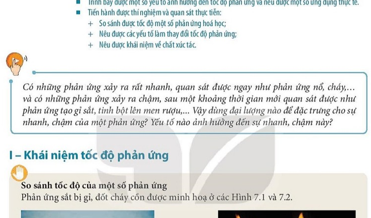

# CHƯƠNG I. PHẢN ỨNG HÓA HỌC

---

# BÀI 7. TỐC ĐỘ PHẢN ỨNG VÀ CHẤT XÚC TÁC

| Khái niệm, thuật ngữ | Kiến thức, kĩ năng |
|---|---|
| - Tốc độ phản ứng - Các yếu tố ảnh hưởng đến tốc độ phản ứng - Nồng độ, nhiệt độ, diện tích tiếp xúc - Áp suất, chất xúc tác | - Nêu được khái niệm tốc độ phản ứng. - Trình bày được ảnh hưởng của nồng độ, nhiệt độ, diện tích tiếp xúc, áp suất và chất xúc tác đến tốc độ phản ứng. - Vận dụng được kiến thức về tốc độ phản ứng để giải thích các hiện tượng trong đời sống và sản xuất. |

---

## 1. Khái niệm tốc độ phản ứng

Trong đời sống, có những phản ứng xảy ra rất nhanh (như phản ứng cháy nổ của thuốc pháo, cồn cháy), nhưng cũng có những phản ứng diễn ra rất chậm (như thanh sắt bị gỉ trong không khí ẩm mất nhiều tháng, sự hình thành thạch nhũ trong hang đá mất hàng nghìn năm).

> [!NOTE]
> **Định nghĩa:**
> **Tốc độ phản ứng** là đại lượng đặc trưng cho sự nhanh hay chậm của một phản ứng hoá học theo thời gian.

---

## 2. Các yếu tố ảnh hưởng đến tốc độ phản ứng

Có 5 yếu tố chính làm thay đổi tốc độ của một phản ứng hoá học:

### 1. Ảnh hưởng của nồng độ chất phản ứng
- Khi **tăng nồng độ** các chất phản ứng, số lượng hạt (phân tử, ion) trong một đơn vị thể tích tăng lên, dẫn đến số lần va chạm hiệu quả giữa các hạt tăng $\rightarrow$ **Tốc độ phản ứng tăng**.
- *Ví dụ:* Tàn đóm đỏ bùng cháy mãnh liệt khi đưa vào bình chứa khí oxygen nguyên chất ($100\%\text{ O}_2$) nhanh hơn nhiều so với để ngoài không khí (chỉ có khoảng $21\%\text{ O}_2$).

### 2. Ảnh hưởng của nhiệt độ
- Khi **tăng nhiệt độ**, các hạt chuyển động nhanh hơn, năng lượng động học tăng, số lần va chạm có hiệu quả tăng mạnh $\rightarrow$ **Tốc độ phản ứng tăng**.
- *Quy tắc kinh nghiệm:* Thông thường khi tăng nhiệt độ thêm $10^\circ\mathrm{C}$, tốc độ phản ứng tăng từ 2 đến 4 lần.
- *Ví dụ:* Nấu thức ăn trong nồi áp suất nhanh chín hơn nồi thường vì nước sôi ở nhiệt độ cao hơn ($> 115^\circ\mathrm{C}$). Bảo quản thức ăn trong tủ lạnh giúp làm chậm quá trình ôi thiu.

### 3. Ảnh hưởng của diện tích tiếp xúc (đối với chất rắn)
- Khi **tăng diện tích bề mặt tiếp xúc** (bằng cách đập nhỏ, nghiền mịn hoặc chẻ nhỏ chất rắn), số lượng hạt trên bề mặt tiếp xúc với chất phản ứng khác tăng lên $\rightarrow$ **Tốc độ phản ứng tăng**.
- *Ví dụ:* Củi chẻ nhỏ cháy nhanh và bốc lửa mạnh hơn khúc gỗ lớn; than tổ ong có nhiều lỗ rỗng để tăng diện tích tiếp xúc với oxygen trong không khí.

### 4. Ảnh hưởng của áp suất (đối với chất khí)
- Đối với phản ứng có chất khí tham gia, khi **tăng áp suất** (thu hẹp thể tích bình chứa), nồng độ chất khí tăng lên $\rightarrow$ **Tốc độ phản ứng tăng**.

### 5. Ảnh hưởng của chất xúc tác
> [!NOTE]
> **Chất xúc tác** là chất làm **tăng tốc độ phản ứng**, nhưng **không bị tiêu hao** hay biến đổi về lượng và chất sau khi phản ứng kết thúc.

- *Ví dụ:* Dung dịch hydrogen peroxide ($\mathrm{H}_2\mathrm{O}_2$) phân hủy rất chậm ở nhiệt độ thường. Khi thêm một lượng nhỏ bột manganese dioxide ($\mathrm{MnO}_2$), bọt khí oxygen ($\mathrm{O}_2$) lập tức sủi lên ồ ạt:
  $$2\mathrm{H}_2\mathrm{O}_2 \xrightarrow{\mathrm{MnO}_2} 2\mathrm{H}_2\mathrm{O} + \mathrm{O}_2 \uparrow$$
- Trong cơ thể sống, các **enzyme** chính là những chất xúc tác sinh học tuyệt vời, giúp các phản ứng tiêu hóa, trao đổi chất diễn ra chớp nhoáng ở nhiệt độ cơ thể ($37^\circ\mathrm{C}$).

---

## 3. Ứng dụng thực tiễn trong đời sống

| Biện pháp thực tế | Yếu tố tác động | Mục đích |
|---|---|---|
| Chẻ nhỏ củi trước khi đun | Diện tích tiếp xúc | Giúp củi bén lửa nhanh, cháy đượm |
| Thổi gió vào bếp than đang đỏ | Nồng độ $\mathrm{O}_2$ | Tăng lượng oxygen giúp than cháy mạnh |
| Dùng nồi áp suất hầm xương | Nhiệt độ & Áp suất | Rút ngắn thời gian nấu, tiết kiệm nhiên liệu |
| Để thức ăn vào ngăn mát tủ lạnh | Nhiệt độ | Giảm tốc độ ôi thiu, kéo dài thời gian bảo quản |
| Muối dưa cà cho thêm chút nước dưa chua cũ | Chất xúc tác (men vi sinh) | Lên men nhanh và đều hơn |
