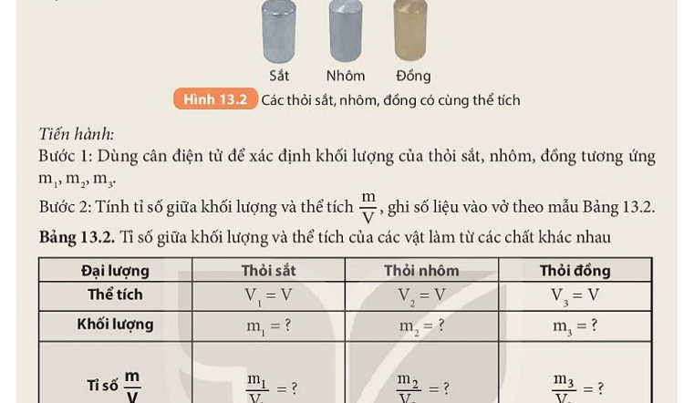

# CHƯƠNG III. KHỐI LƯỢNG RIÊNG VÀ ÁP SUẤT

---

# BÀI 13. KHỐI LƯỢNG RIÊNG

| Khái niệm, thuật ngữ | Kiến thức, kĩ năng |
|---|---|
| - Khối lượng riêng ($D$) - Trọng lượng riêng ($d$) - Đơn vị đo ($\mathrm{kg/m^3}, \mathrm{g/cm^3}$) | - Phát biểu được định nghĩa khối lượng riêng. - Viết được công thức tính khối lượng riêng $D = \frac{m}{V}$. - Đổi được các đơn vị khối lượng riêng. - Xác định được khối lượng riêng của các vật rắn, chất lỏng bằng thực nghiệm. |

---

## 1. Khối lượng riêng là gì?

Trong đời sống, ta thường nói "sắt nặng hơn nhôm", "dầu nhẹ hơn nước". Nhưng nếu lấy $1\text{ tấn}$ nhôm so với $1\text{ chiếc}$ đinh sắt thì rõ ràng nhôm nặng hơn! Do đó, để so sánh mức độ "nặng hay nhẹ" của các chất, người ta phải so sánh **khối lượng của cùng một đơn vị thể tích** ($1\mathrm{ m^3}$ hoặc $1\mathrm{ cm^3}$).

> [!NOTE]
> **Định nghĩa:**
> **Khối lượng riêng** của một chất là khối lượng của một đơn vị thể tích chất đó.

### Công thức tính khối lượng riêng:
$$D = \frac{m}{V}$$

Trong đó:
- $D$: Khối lượng riêng của chất (đơn vị $\mathrm{kg/m^3}$ hoặc $\mathrm{g/cm^3}$).
- $m$: Khối lượng của vật (đơn vị $\mathrm{kg}$ hoặc $\mathrm{g}$).
- $V$: Thể tích của vật (đơn vị $\mathrm{m^3}$ hoặc $\mathrm{cm^3}$, $\mathrm{mL}$).

$$\implies m = D \cdot V; \qquad V = \frac{m}{D}$$

### Quy đổi đơn vị:
$$1\mathrm{ g/cm^3} = 1000\mathrm{ kg/m^3}$$
$$1\mathrm{ m^3} = 1000\text{ lít} = 1\,000\,000\mathrm{ cm^3}$$

---

## 2. Bảng khối lượng riêng của một số chất thông dụng

| Chất | Thể | Khối lượng riêng $D$ ($\mathrm{kg/m^3}$) |
|---|---|---|
| Chì ($\mathrm{Pb}$) | Rắn | $11\,300$ |
| Sắt ($\mathrm{Fe}$) | Rắn | $7\,800$ |
| Nhôm ($\mathrm{Al}$) | Rắn | $2\,700$ |
| Nước nguyên chất ($4^\circ\mathrm{C}$) | Lỏng | $1\,000$ |
| Xăng, dầu hỏa | Lỏng | $700 - 800$ |
| Thủy ngân ($\mathrm{Hg}$) | Lỏng | $13\,600$ |
| Không khí ($0^\circ\mathrm{C}, 1\mathrm{ atm}$) | Khí | $1,29$ |

> [!TIP]
> **Hiện tượng đời sống (Bác học Newton giải thích):**
> Tại sao dầu ăn hay xăng luôn nổi lên trên mặt nước?
> Bởi vì khối lượng riêng của dầu hỏa ($D \approx 800\mathrm{ kg/m^3}$) nhỏ hơn khối lượng riêng của nước ($D = 1000\mathrm{ kg/m^3}$). Do đó khi xảy ra cháy xăng dầu, tuyệt đối không dùng nước để dập lửa vì xăng dầu nổi lên mặt nước sẽ làm đám cháy lan rộng hơn!
