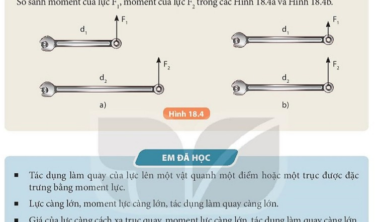

# CHƯƠNG IV. TÁC DỤNG LÀM QUAY CỦA LỰC

---

# BÀI 19. ĐÒN BẨY VÀ ỨNG DỤNG

| Khái niệm, thuật ngữ | Kiến thức, kĩ năng |
|---|---|
| - Đòn bẩy - Điểm tựa ($O$) - Cánh tay đòn ($d_1, d_2$) - Quy tắc đòn bẩy | - Nhận biết được các thành phần của đòn bẩy: điểm tựa $O$, điểm tác dụng của lực $O_1, O_2$. - Nêu được quy tắc cân bằng của đòn bẩy $F_1 \cdot d_1 = F_2 \cdot d_2$. - Giải thích được tác dụng làm lợi về lực hoặc lợi về đường đi của đòn bẩy trong đời sống (kéo cắt kim loại, bập bênh, kìm nhổ đinh, xe cút kít). |

---

## 1. Cấu tạo của đòn bẩy

Đòn bẩy là một trong những máy cơ đơn giản được con người sử dụng từ thời cổ đại để nâng và di chuyển các vật nặng một cách dễ dàng.

Mỗi đòn bẩy đều có 3 yếu tố cốt lõi:
1. **Điểm tựa (kí hiệu $O$):** Là điểm cố định mà đòn bẩy quay quanh nó.
2. **Điểm tác dụng của lực cần nâng $F_1$ (kí hiệu $O_1$):** Nơi đặt vật nặng cần bẩy.
3. **Điểm tác dụng của lực tác dụng bởi người $F_2$ (kí hiệu $O_2$):** Nơi tay ta cầm ấn xuống hoặc nâng lên.
- $d_1 = O O_1$: Khoảng cách từ điểm tựa đến giá của lực $F_1$.
- $d_2 = O O_2$: Khoảng cách từ điểm tựa đến giá của lực $F_2$.

---

## 2. Điều kiện cân bằng và quy tắc đòn bẩy

> [!NOTE]
> **Quy tắc đòn bẩy (Archimedes):**
> Đòn bẩy nằm cân bằng khi tích của lực tác dụng với cánh tay đòn của nó ở hai bên điểm tựa bằng nhau:
> $$F_1 \cdot d_1 = F_2 \cdot d_2$$
> $$\implies \frac{F_2}{F_1} = \frac{d_1}{d_2}$$

### Các trường hợp đòn bẩy:
1. **Được lợi về lực ($F_2 < F_1$):** Khi cánh tay đòn $d_2 > d_1$. Cánh tay đòn của tay người dài hơn cánh tay đòn của vật nặng.
   - *Ứng dụng:* Xà beng nạy đá, kìm bấm cốt kim loại, kéo cắt sắt, kìm nhổ đinh.
2. **Bị thiệt về lực nhưng được lợi về đường đi ($F_2 > F_1$):** Khi $d_2 < d_1$.
   - *Ứng dụng:* Kéo cắt vải/giấy (lưỡi kéo dài giúp đường cắt nhanh và ngọt), cần câu cá, nhíp gắp vật nhỏ.

> [!TIP]
> **Câu nói nổi tiếng của Archimedes:**
> *"Hãy cho tôi một điểm tựa, tôi sẽ nhấc bổng cả Trái Đất lên!"*
> Ý của ông là nếu có một điểm tựa vững chắc và một cánh tay đòn $d_2$ đủ dài, lực tác dụng của một người bình thường cũng có thể cân bằng được trọng lực khổng lồ của cả hành tinh.
