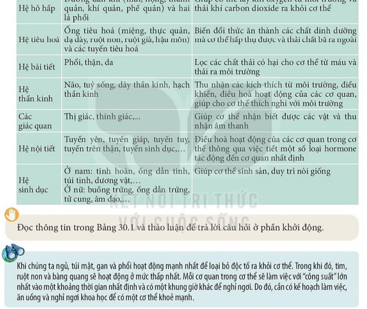

# CHƯƠNG VII. SINH HỌC CƠ THỂ NGƯỜI

---

# BÀI 31. HỆ VẬN ĐỘNG Ở NGƯỜI

| Khái niệm, thuật ngữ | Kiến thức, kĩ năng |
|---|---|
| - Bộ xương người - Các khớp xương (khớp động, bán động, bất động) - Cơ bắp, sự co cơ - Cong vẹo cột sống | - Nêu được cấu tạo và chức năng của bộ xương người. - Phân biệt được các loại khớp xương. - Giải thích được cơ chế co cơ và hiện tượng mỏi cơ. - Nêu được các biện pháp bảo vệ hệ vận động và phòng chống tật cong vẹo cột sống ở học sinh. |

---

## 1. Cấu tạo bộ xương người

Bộ xương người trưởng thành gồm khoảng $206$ chiếc xương, chia làm 3 phần chính:
1. **Xương đầu:** Gồm khối xương sọ (bảo vệ não) và các xương mặt.
2. **Xương thân:** Gồm cột sống (33 - 34 đốt sống) và lồng ngực (12 đôi xương sườn gắn với xương ức).
3. **Xương chi:** Gồm xương chi trên (tay) và xương chi dưới (chân).

### Các loại khớp xương:
- **Khớp động:** Cử động linh hoạt, biên độ lớn (khớp vai, khớp khuỷu tay, khớp gối, khớp háng). Giữa các đầu khớp có sụn và bao hoạt dịch chứa chất nhờn giảm ma sát.
- **Khớp bán động:** Cử động hạn chế (khớp giữa các đốt sống, khớp bán động mu).
- **Khớp bất động:** Không cử động được, giúp bảo vệ vững chắc (khớp giữa các xương sọ).

---

## 2. Hệ cơ và cơ chế hoạt động

Cơ thể người có khoảng $600$ cơ bắp, chủ yếu là **cơ vân** bám vào xương thông qua các **gân**.

### Cơ chế co cơ:
- Khi có xung thần kinh kích thích, các tơ cơ mảnh trượt sâu vào giữa các tơ cơ dày làm cho bắp cơ ngắn lại và phình to ra $\rightarrow$ Kéo xương chuyển động quanh khớp.
- **Hiện tượng mỏi cơ và chuột rút (Bản chất sinh lý):**
  - Khi vận động quá mức trong thời gian dài, cơ thể thiếu khí oxygen ($\mathrm{O}_2$), tế bào cơ chuyển sang hô hấp kị khí sinh ra **lactic acid** tích tụ trong cơ bắp, gây ức chế dẫn truyền thần kinh và đau mỏi.
  - Sự mất cân bằng các ion điện giải như $\mathrm{Ca}^{2+}, \mathrm{Mg}^{2+}, \mathrm{K}^{+}$ do đổ mồ hôi nhiều là nguyên nhân chính dẫn đến **chuột rút** (co cứng cơ đột ngột ngoài ý muốn).

---

## 3. Vệ sinh và rèn luyện hệ vận động

> [!TIP]
> **Phòng chống cong vẹo cột sống học đường:**
> - Ngồi học đúng tư thế: Lưng thẳng, ngực không tì vào mép bàn, hai chân chạm đất vuông góc, khoảng cách từ mắt đến vở khoảng $25 - 30\mathrm{ cm}$.
> - Đeo cặp sách trên cả 2 vai, không đeo lệch một bên vai hoặc xách cặp quá nặng ($> 10\%$ trọng lượng cơ thể).
> - Thường xuyên tắm nắng sớm để cơ thể tổng hợp Vitamin D giúp hấp thụ Calcium ($\mathrm{Ca}$) làm xương chắc khỏe.
